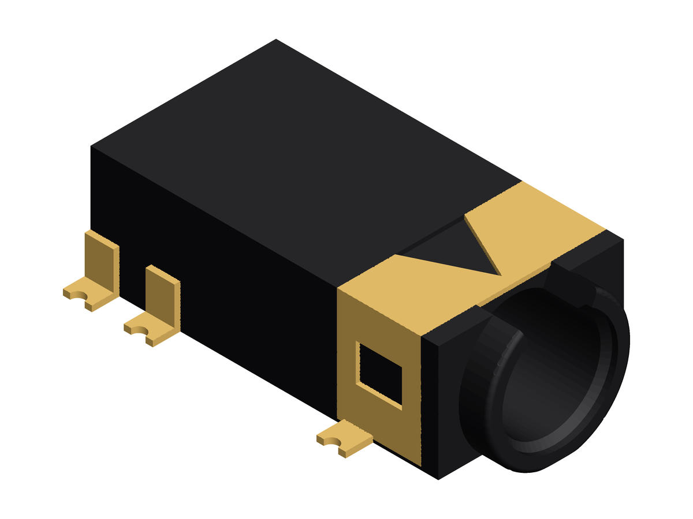

# PJ-3106M 3D model

A simplified 3D model of the **HOOYA PJ-3106M** 3.5 mm 4-pole SMD phone jack
([LCSC C7428681](https://www.lcsc.com/product-detail/C7428681.html)), for the KiCad
footprint 3D viewer. It is generated with [CadQuery](https://cadquery.readthedocs.io/) from
the vendor drawing (HAOYU/HOOYA "PJ-3106M (YBC01)", rev A). See [Provenance](#provenance).



Outputs (committed, so you don't need Python just to use the model):

| File | Use |
|---|---|
| [`models/PJ-3106M.step`](models/PJ-3106M.step) | KiCad 3D model: 8 coloured solids (black housing, gold front shell, 6 gold leads) |
| [`models/PJ-3106M.stl`](models/PJ-3106M.stl) | Single watertight mesh (mm) |

The model is simplified but recognisable. Features:

- **Housing** (matte near-black) with a square front flange, the short round nose and the
  rear locating peg. The nose rim is cut flat at the housing top, so **the whole part is
  4.00 mm high**. The nose has a raised outer ring, a notch above the bore, and the Ø3.60
  plug bore with a chamfered entry. Below the board, the nose is trimmed flat to 3.0 mm
  wide and 0.50 mm deep, so it fits the 3.2 mm board cutout.
- **Gold front shell** over the top and sides of the front section, with a V-shaped
  tongue on top and a window in each side. Its side walls run down to 0.10 mm above the
  board. It sits in a pocket, so the 6.40 × 4.00 envelope is unchanged.
- **Six gold SMD leads** with forked tips. The two leads under the shell (pins 1 and 4) have
  no side tab.

Out of scope: internal contacts and springs, the ground tongue in the rim notch, top
windows, the embossed marking, and the underside channels.

## Provenance

- **Source:** the vendor drawing HAOYU/HOOYA "PJ-3106M (YBC01)", rev A. It is a single-page
  vector PDF, and it is the datasheet the LCSC C7428681 product page serves. Its PDF is not
  in this repository (see [Source documents](#source-documents)).
- **Earlier versions of this model were built from the wrong part.** They used the LCSC
  C2939583 (HOOYA PJ-31060) drawing and photos. That drawing differs in pin numbering, lead
  positions, axis height, nose length, peg and pads, so every value was re-derived from the
  PJ-3106M drawing.
- **Estimates:** values the drawing doesn't dimension were measured off the drawing
  rasterised at 1200 dpi. Each view was calibrated on one of its own printed dimensions:
  the 4.0 height (front and right views), the 12.0 length (side view), the 11.5 pin-5
  position (top view) and the 6.4 width (end view). The PCB layout isn't drawn to scale,
  so no value was measured off it. Every number lives in
  [`src/pj3106m_model/params.py`](src/pj3106m_model/params.py), commented `datasheet` or
  `estimate`.
- **Photos:** the LCSC C7428681 product photos were used for colours and appearance (black
  PA9T housing, gold shell and leads, flat rim, notch above the bore). They were also used
  for one estimate: the shell side walls, which reach almost to the board. The drawing's
  side views put the wall bottom about 0.5 mm up; we followed the photos. The photos are
  not in this repository.

### Dimensions

Feature | mm | Source
:--- | ---: | :---
Housing length | 12.00 | datasheet
Housing width | 6.40 | datasheet
Housing height (= overall height, flat top) | 4.00 | datasheet
Nose projection in front of the housing | 1.00 | datasheet
Overall length | 13.00 | datasheet
Plug axis height | 1.85 | datasheet
Plug axis lateral offset | 0.00 | estimate
Plug bore diameter | 3.60 | datasheet
Nose width below the board | 3.00 | datasheet
Nose extent behind the front face (board cutout depth) | 1.10 | datasheet
Peg distance behind the front face | 10.70 | datasheet
Peg diameter (Ø1.2 +0/−0.1) | 1.15 | datasheet
Peg length below the board | 0.50 | datasheet
Lead tip span | 8.30 | datasheet
Lead width | 1.00 | datasheet
Lead thickness | 0.20 | datasheet
Pins 1 / 4 behind the front face | 2.75 | datasheet
Pin 3 behind the front face | 5.50 | datasheet
Pin 2 behind the front face | 9.40 | datasheet
Pin 6 behind the front face | 10.50 | datasheet
Pin 5 behind the front face | 11.50 | datasheet
Pad along the plug axis × across | 1.50 × 2.60 | datasheet
Pad outer span | 8.80 | datasheet
Peg hole diameter (PCB) | 1.60 | datasheet
Nose board cutout width | 3.20 | datasheet
Nose diameter | 5.00 | estimate
Nose dip below the board | 0.50 | estimate
Nose-face recess diameter / depth | 4.00 / 0.20 | estimate
Bore entry chamfer | 0.20 | estimate
Bore depth from the nose tip | 11.00 | estimate
Flange thickness | 0.60 | estimate
Rim notch width top / bottom / depth | 2.70 / 2.00 / 0.70 | estimate
Shell rear edge behind the front face | 3.50 | estimate
Shell sheet thickness | 0.15 | estimate
Shell side wall bottom above the board | 0.10 | estimate
Shell V tongue rear width / apex gap | 2.40 / 0.40 | estimate
Shell window length × height / centre height | 1.60 × 1.30 / 2.10 | estimate
Lead side tab height | 1.50 | estimate
Lead fork diameter | 0.50 | estimate

## Source documents

The datasheet and product photos are **not stored in git**. The model, tests and build
don't need them. They're identified by:

| | |
|---|---|
| Vendor / model | HAOYU (HONGKONG) LIMITED / HOOYA ELECTRONICS, "PJ-3106M (YBC01)" |
| Datasheet revision | A (vector drawing, 1 page; PDF created 2019-09-10) |
| Datasheet SHA-256 | `88db1b26c288bbaa0537e7a184d20efc260de7c7e152d95f0d4d86067e96ea4f` |
| Distributor | LCSC [C7428681](https://www.lcsc.com/product-detail/C7428681.html): datasheet PDF and product photos (`20230720_HOOYA-PJ-3106M_C7428681_{front,back,blank}.jpg`) |

To check a downloaded copy anywhere on disk (the path isn't recorded anywhere):

```sh
uv run pj3106m-datasheet --datasheet ~/Downloads/PJ-3106M.pdf
# or
export PJ3106M_DATASHEET=~/Downloads/PJ-3106M.pdf
uv run pj3106m-datasheet
```

The command exits 0 on a match, 1 if the file is a different document or revision (it
prints both hashes; compare the dimensions in `params.py` by hand), and 2 if no path is
given or the file is missing. If you keep copies inside the repo, put them in `local/`,
which is gitignored.

## Setup

1. Install [uv](https://docs.astral.sh/uv/):

   ```sh
   curl -LsSf https://astral.sh/uv/install.sh | sh   # or: pipx install uv / brew install uv
   ```

2. Create the environment. uv installs the pinned Python (3.12, from `.python-version`;
   CadQuery needs 3.10–3.12) and the locked dependencies from `uv.lock`:

   ```sh
   uv sync
   ```

   > **Network filesystem checkouts:** keep the large venv out of the workspace
   > and avoid hard-link warnings:
   >
   > ```sh
   > export UV_PROJECT_ENVIRONMENT="$HOME/.venvs/pj3106m"
   > export UV_LINK_MODE=copy
   > ```
   >
   > Set these before every `uv` command (e.g. in your shell rc or a direnv `.envrc`).

## Build and test

```sh
uv run pj3106m-build             # regenerate models/PJ-3106M.{step,stl}
uv run pj3106m-build --preview   # also write SVG projections to build/ (gitignored)
uv run pj3106m-build --render    # also regenerate the README image docs/PJ-3106M_iso.png
uv run pj3106m-build --out DIR   # write the outputs somewhere else
uv run pytest                    # dimensional checks against the datasheet
```

After changing any geometry, rebuild with `--render` and commit `models/` and
`docs/PJ-3106M_iso.png`. A test fails if the committed STEP/STL outputs are stale. The
image isn't checked byte-for-byte (matplotlib output can vary between versions), so
regenerate it yourself.

## Coordinate frame

The model follows KiCad's 3D model convention, so it needs **no offset, rotation or
scaling** in KiCad:

- Units are mm. **Z = 0 is the seating plane** (PCB top surface) and +Z is up. The nose
  and the peg both dip 0.50 mm below the board, as on the real part. Nothing is higher
  than Z = 4.00.
- **Origin = centroid of the six-pad pattern.** The housing front face is at Y = +7.125,
  the nose tip at Y = +8.125, the rear peg at (X 0, Y −3.575), and the plug axis at
  X = 0, Z = 1.85.
- The **plug opening faces +Y** (toward the top of the screen in the footprint editor).
  **Pins 2/4/5 are on +X, pins 1/3/6 on −X.**

Pad centres for a matching footprint (KiCad footprint coordinates, Y pointing down), all
pads 2.60 (X) × 1.50 (Y), outer pad edges 8.80 apart:

| Pin | X | Y |
|---|---|---|
| 1 | −3.10 | −4.375 |
| 3 | −3.10 | −1.625 |
| 6 | −3.10 | +3.375 |
| 4 | +3.10 | −4.375 |
| 2 | +3.10 | +2.275 |
| 5 | +3.10 | +4.375 |

Plus an NPTH Ø1.60 hole at (0, +3.575). The nose needs a 3.20 mm wide board-edge cutout
that reaches 1.10 mm behind the board edge (datasheet PCB layout; the board edge is at the
housing front face, Y = −7.125 in footprint coordinates).

To use a different footprint origin, change `FRONT_Y` (and `AXIS_X` for lateral offsets)
in `params.py` and rebuild.

## Using it in KiCad

In the footprint's **3D Models** tab, add the STEP file with offset (0, 0, 0), rotation
(0, 0, 0) and scale 1. For example, using a path variable that points at this repo:

```
${PJ3106M_DIR}/models/PJ-3106M.step
```

## Layout

```
pyproject.toml, .python-version, uv.lock   # reproducible uv environment
src/pj3106m_model/params.py                # every dimension (datasheet / estimate)
src/pj3106m_model/model.py                 # CadQuery geometry
src/pj3106m_model/build.py                 # pj3106m-build CLI
src/pj3106m_model/render.py                # matplotlib isometric PNG render
tests/test_pj3106m.py                      # datasheet dimensional tests
tests/test_render.py                       # README image checks
tests/test_readme_dimensions.py            # README table == params.py
models/                                    # committed STEP/STL outputs
docs/                                      # committed README image
openspec/                                  # OpenSpec specs and changes
```

## License

[MIT](LICENSE). This covers the code and the generated models. It does not cover the
vendor datasheet or the product photos, which aren't in this repository.
